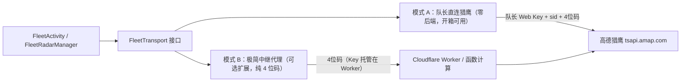
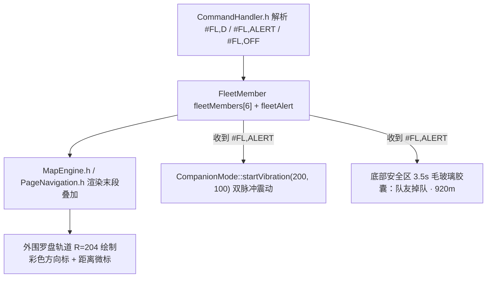

# 技术设计方案：高德猎鹰互联套件（车队组队雷达 · 足迹热力图 · 防盗哨兵）

> **当前状态**：`设计已归档 · 暂缓实现（欢迎社区共建 PR）`  
> **延后说明**：本套件涉及额外申请高德开放平台「Web 服务 Key（猎鹰轨迹服务）」以及多台实机/多人联调路测，维护者当前优先聚焦核心导航流畅度与现有功能打磨，因此暂不进入编码。本文档作为完整技术实现蓝图保存在代码仓库中，欢迎有兴趣的开源开发者阅读、讨论并基于此方案提交 PR 实现。  
> **适用代码基线**：Android 标准版 `android/standard`（后续可同步融合读秒版）、M5Stack Stopwatch 固件 `firmware/boards/stopwatch/MotoNav`（后续可同步 Waveshare 1.75 / 1.85B）。  
> **核心约束**：所有高德云端能力均须具备**开源地图引擎或未配置 Web Key 时的平滑回退机制**，不可崩溃、不可阻塞主导航链路。

---

## 一、总体架构与关键技术决策

### 1.1 技术选型：为什么用「高德猎鹰 REST API」而非「猎鹰 Android SDK」？

| 对比维度 | 高德猎鹰 Android SDK (`com.amap.api:track`) | 高德猎鹰 REST API (`https://tsapi.amap.com/v1/track/...`) |
| :--- | :--- | :--- |
| **依赖冲突风险** | **高**。项目已集成新版合包 `navi-3dmap-location-search:10.1.600`，猎鹰 Android SDK 更新滞后，内置定位库与 `.so` 极易冲突 | **零冲突**。基于 Android 原生 `HttpURLConnection` 即可完成调用，不引入任何新第三方依赖与 `.so` |
| **电量与定位复用** | 独立启动定位服务，与现有 `NavService` 重复定位、增加耗电 | 直接复用 `NavService` 与 `RideRecorder` 现有的高质量定位流，零额外 GPS 功耗 |
| **车队功能支持** | 仅适合单终端采集，不支持动态创建 Service 与按自定义属性检索全队终端 | **全能力支持**：`service/add`、`terminal/add`、`point/upload`（批量）、`terminal/search`（单次查全队）、`trsearch`（官方绑路纠偏）、`geofence/*` |
| **引擎解耦与回退** | 强绑定高德 Android SDK | 天然可抽象为 `TrackBackend` 接口，开源引擎 / 离线模式可无缝切换本地实现 |

**设计结论**：采用纯 HTTPS 对接高德猎鹰 REST API（`tsapi.amap.com/v1`），在 `Keys.kt` 中新增一个**可选填**的「高德 Web 服务 Key（猎鹰专用）」。未填写时不影响任何现有导航功能。

---

### 1.2 核心痛点破局：零后端开源项目中，4 位组队码如何跨用户互通？

高德猎鹰的 `Service (sid)` 绑定在创建它的**高德 Web 服务 Key** 下。由于本项目没有官方中心服务器，用户各自填写自己的高德 Key，不同 Key 无法直接访问同一个 `sid`。

为此设计**双模式可插拔传输层 `FleetTransport`**：

- **模式 A（零服务器 · 队长共享车队口令 — 推荐首期实现）**：
  1. **队长端**：仅队长需要填写一次自己的高德 Web 服务 Key。点击「创建车队」时，App 自动在队长账号下初始化/复用名为 `motonav_fleet` 的 `Service (sid)`，生成 4 位随机组队码（如 `4829`），并生成一条可一键复制的**车队口令**或二维码：
     - 格式示例：`MNT1:<Base64Url(json{"c":"4829","s":123456,"k":"<webKey>","n":"周末跑山"})>`
  2. **队员端**：**无需申请高德 Web 服务 Key**。点击「加入车队」，扫码或粘贴微信群里的车队口令（支持剪贴板自动识别），即可直接加入同一个 `sid`；同一车队下次再组，只需输入新 4 位码即可复用已缓存的 `sid`。
  3. **安全与风控**：UI 提醒队长在高德控制台为该 Web Key 设置每日调用配额上限（个人免费额度足够 10 人车队全天使用），并可随时停用或更换 Key。
- **模式 B（极简无状态中继 — 适合公开车友会）**：
  - 若社区或车队自建一个约 120 行的 Cloudflare Worker / 云函数转发 `tsapi.amap.com`（将统一 Web Key 托管在服务端），客户端只需在设置中填入中继 URL 即可实现“所有成员纯输 4 位数字码直接入队”，上层业务与固件协议**零改动**。

---

### 1.3 硬件边界评估：副屏防盗电子围栏的可行性

ESP32-S3 圆屏本身**没有蜂窝网络（4G/NB-IoT）与独立 GPS**，离开手机蓝牙覆盖范围后无法主动向高德猎鹰上报坐标，因此“仅靠圆屏 + 高德服务端电子围栏”在物理上不可行。

本方案将其拆解为 **L1（零新增硬件 · 近场蓝牙 + IMU 异动哨兵）+ L2（闲置旧手机复用猎鹰电子围栏）+ L3（外接 4G/GPS 硬件预留）** 三层递进架构（详见第四节）。

---

## 二、模块 1：车队组队骑行雷达（Fleet Radar）

### 2.1 高德猎鹰数据模型映射

- **Service (`sid`)**：车队共享空间。首次创建时调用 `POST /v1/track/service/add`，并通过 `POST /v1/track/column/add` 注册自定义字段：
  - `team`（string，开启索引）：4 位组队码，如 `"4829"`
  - `nick`（string）：队员昵称（≤ 12 字符）
  - `tag`（string）：圆屏 1~2 字符短代号（如 `"L"`、`"1"`、`"A"`，避免圆屏字库缺失）
  - `role`（int）：`1` = 队长，`0` = 队员
- **Terminal (`tid`)**：每台手机按 `SHA1(ANDROID_ID + "mn_fleet").take(8)` 生成唯一终端名 `mn_xxxxxxxx`，入队时调用 `terminal/list` 查找，不存在则 `terminal/add` 创建并更新 `props`。
- **Trace (`trid`)**：每次入队调用 `POST /v1/track/trace/add` 生成本次车队轨迹 ID，同时兼容轨迹归档。

### 2.2 手机端核心引擎（`FleetRadarManager.kt`）

1. **上传与拉取节拍（兼顾实时性与 QPS / 省电）**：
   - **上报自身坐标**：骑行中（速度 > 3 km/h）每 **3 秒** 调用 `POST /v1/track/point/upload`；静止状态降频至 **10 秒**。携带 `location(lng,lat)`、`locatetime(ms)`、`speed(km/h)`、`direction(deg)`。
   - **拉取队友坐标**：每 **3 秒** 调用一次 `POST /v1/track/terminal/search`（条件 `filter=team:<4位码>`），**单次 HTTP 请求直接返回同队所有成员的最新 `lastpoint` 与 `props`**，避免按人数逐个请求 `lastpoint` 浪费配额。
   - **在线/离线判定**：
     - `now - locatetime <= 30s`：在线（正常渲染）；
     - `30s < delta <= 300s`：信号弱/暂离（置灰标志）；
     - `delta > 300s`：从圆屏雷达隐藏（手机端列表仍可查看最后位置）。
2. **相对方位角与距离计算（`FleetMath.kt`）**：
   - 使用 Haversine 公式计算球面距离 $d$（米）与真北方位角 $\beta_{true} \in [0, 360)$。
   - 结合本车当前航向角 `myHeading`（优先路网匹配航向，巡航时取 GPS bearing，低速静止时保持上次有效航向），计算相对车头夹角：
     $$\theta_{rel} = (\beta_{true} - \text{myHeading} + 360) \bmod 360$$
     - `0°` = 正前方，`90°` = 正右方，`180°` = 正后方，`270°` = 正左方。
   - **前/后车语义色**：
     - 掉队状态 → 红色（`colorId = 5`）；
     - 前方（`relDeg <= 75 || relDeg >= 285`）→ 亮绿色（`colorId = 0`）；
     - 侧方/后方（`75 < relDeg < 285`）→ 明黄色（`colorId = 1`）；
     - 队长附带 `flags` bit0 标记（圆屏绘制双环区分）。
   - **上屏上限**：按「掉队优先 → 距离由近及远」最多取 **6 名** 队友下发圆屏。
3. **掉队报警状态机（防抖 + 滞回 + 冷却）**：
   - 可配阈值：`dropThresholdM`（默认 **800m**，支持 500m / 800m / 1200m / 2000m）。
   - **触发条件**：在线队友 `dist > dropThresholdM` **连续满足 2 个同步周期（≥ 6s）**，且己方或对方速度 > 5 km/h（避免停车休息误报）。
   - **滞回解除**：距离回到 `dist < dropThresholdM * 0.8`（即 640m）后清除掉队态。
   - **冷却时间**：同一队友两次主动弹窗 + 震动报警间隔不少于 **60 秒**。

### 2.3 BLE 通信协议扩展

沿用项目现有文本指令规范（下行 `#` 开头，上行 `T,` 开头，单包远小于 `RXQ_MAX = 512`）：

| 方向 | 指令格式 | 说明 |
| :--- | :--- | :--- |
| 手机 → 圆屏 | `#FL,OFF` | 退出车队，圆屏立即清空所有队友圆点与报警状态 |
| 手机 → 圆屏 | `#FL,D,<code4>,<total>,<n>,<m0>,<m1>,...` | 下发当前车队相对雷达数据（每 3 秒或航向变化 > 8° 时节流下发，最高 2Hz） |
| 手机 → 圆屏 | `#FL,ALERT,<idx>,<distM>,<shortTag>` | 触发队友掉队报警（圆屏震动 + 轻量提示条） |
| 圆屏 → 手机 | `T,FL_PING` | （可选）圆屏轻触车队状态向队友发送集合/注意提示 |

单个成员 `<mi>` 编码格式：`idx:relDeg:distM:flags:colorId:shortTag`
- 示例：`#FL,D,4829,4,2,0:12:150:1:0:L,1:195:420:0:1:2`
  - 队友 0：车头偏右 12°、150m、队长(`flags=1`)、绿点(`colorId=0`)、短代号 `L`；
  - 队友 1：车尾偏左 15°(`195°`)、420m、队员(`flags=0`)、黄点(`colorId=1`)、短代号 `2`。

### 2.4 圆屏端渲染设计（466×466 AMOLED）

涉及文件：新增 `FleetRadar.h`，修改 `GlobalConfig.h`、`CommandHandler.h`、`MapEngine.h`、`PageNavigation.h`。

- **外围罗盘几何布局**：
  - 屏幕圆心 `(233, 233)`，最外环 `TRIP_RING_R = 229`，路口环 `TURN_RING_R = 219`。
  - 队友雷达点轨道半径设为 **`R_FLEET = 204`**，紧贴内环内侧，不压住进度环与路口倒计时环。
  - 屏幕坐标换算：`rad = (relDeg - 90.0f) * DEG_TO_RAD`，`x = CX + cosf(rad) * R_FLEET`，`y = CX + sinf(rad) * R_FLEET`。
  - **防遮挡避让**：复用 `DragonRadar.h` 中 `placeEdgeBall` 角度微偏移思路，避开顶部车速块与右侧红绿灯卡片；多名队友夹角 `< 14°` 时自动径向错位。
  - **视觉样式**：半径 6px 实心亮色圆点（1px 黑色描边防底图吃色）+ 指向外缘的 4px 微型三角；紧贴内侧显示微型距离（`< 1000m` 显示 `150m`，`≥ 1000m` 显示 `1.2k`）。
- **掉队报警表现**：
  - 调用 `CompanionMode::startVibration(200, 100)` 双脉冲短震；
  - 在屏幕偏下方安全区域（`y = 355`，不挡中央转弯箭头与路名）弹出 3.5 秒红橙色毛玻璃胶囊：`队友2 掉队 · 920m`（中英文随 `isChineseLang` 自适应）；
  - 掉队队友圆点 2Hz 呼吸闪烁，直至恢复。
- **渲染开销**：最多 6 个圆点 + 6 段短文本，每帧叠加耗时 `< 0.4ms`，对现有地图帧率无感。

### 2.5 手机端 UI（`FleetActivity.kt`）

- 首页新增「车队组队」入口卡片（未入队显示创建/加入，入队后常驻显示 `车队 4829 · 3人在线`）。
- `FleetActivity` 包含：组队操作区（4 位码 / 口令 / 二维码）、实时队形地图（高德地图 Marker + 一键导航至队友；开源模式回退 Canvas 极坐标雷达）、成员列表与参数设置（昵称、短代号、掉队阈值、震动开关）。

---

## 三、模块 2：云端足迹热力图与年度骑行报告

### 3.1 双轨架构：猎鹰云端纠偏 + 本地 `RideRecorder` 无缝兜底

基于现有 `RideRecorder.kt`（已将本地骑行保存在 `noBackupFilesDir/ride_tracks/`），实现**“配高德 Web Key 享云端归档与官方绑路纠偏，未配 Key 或开源引擎同样 100% 可用热力图与年度报告”**：

1. **云端归档与纠偏管道（`TrackCloudSync.kt`）**：
   - 在 `RideSummary` 向后兼容地扩展可选字段：`cloudTrid: Long?`、`cloudSynced: Boolean`、`correctedMeters: Double?`、`adcodes: List<String>`、`climbM: Int`。
   - 骑行结束后后台按每批 **90 点**（猎鹰单次上限 100 点）分片调 `POST /v1/track/point/upload` 上传至个人专属 `motonav_personal` Service。
   - 调用 `GET https://tsapi.amap.com/v1/track/terminal/trsearch`（参数 `correction=denoise=1,mapmatch=1,attribute=0,threshold=50,mode=driving`）拉取高德官方绑路纠偏轨迹与精准里程，持久化缓存至本地 `corrected_<id>.jsonl`，后续展示不再消耗配额。
   - 支持换机后从猎鹰云端拉取近 1 年轨迹恢复足迹。

### 3.2 足迹聚合与年度统计引擎（`FootprintAnalyzer.kt`）

- **热力网格聚合**：按 `0.005°`（~500m）网格聚合频次生成 `List<WeightedLatLng>`，采用对数权重压缩 `weight = ln(1 + count)`，防止高频通勤点压暗长途摩旅足迹。
- **点亮省市统计**：每条轨迹首/中/尾（长途每 30km 补采）经本地 5km 网格缓存 `adcode_cache.json` + 高德逆地理编码解析 `province` / `city` / `adcode`；开源/离线模式自动回退仅统计里程/时长/极值。
- **年度指标**：总里程、总时长、总趟次、点亮省市数、单次最远里程、最高时速、累计爬升、12 个月里程柱状图、出发时段偏好与年度骑士称号。

### 3.3 界面与朋友圈长图海报

- **足迹地图页（`FootprintActivity.kt`）**：入口置于 `RideHistoryActivity` 顶部。高德模式复用现有合包自带的 `HeatmapTileProvider` + `TileOverlay` 绘制暗夜霓虹渐变热力图，支持切换年份及 `热力图 / 轨迹光轨 / 点亮城市` 视图；开源/离线模式回退为原生 Canvas 暗夜轨迹光轨图。
- **长图海报生成（`AnnualReportPoster.kt`）**：使用原生 `Bitmap(1080, 2400)` + `Canvas` 离屏绘制高清竖版年度报告长图（融合 `AMap.getMapScreenShot` 暗夜羽化背景 + 4 宫格核心指标 + 12 月柱状图 + 点亮城市标签墙），支持写入 `MediaStore` 保存相册及 `FileProvider` 一键分享。

---

## 四、模块 3：车辆停放电子围栏防盗告警（分层方案）

针对 ESP32 圆屏无 4G/GPS 的物理限制，按硬件形态分为三层：

1. **L1（零新增硬件 · 近场蓝牙 + IMU 异动哨兵）**：
   - 适用于路边歇脚/便利店/露营（人与车距离 ≤ 25m）。
   - 复用 `ParkingBeacon.h` 驻车低功耗架构，新增开关 `#PKB,SENTRY,1`；圆屏息屏期间以 2Hz 轮询板载 IMU（如 Stopwatch 的 BMI270），若检测到持续异常震动或车身倾斜突增 `> 15°` 持续 1.5s，立即通过 BLE 上发 `T,SENTRY_ALM` 并全屏红闪，手机端即刻拉响高优先级警报通知。
2. **L2（零新购硬件 · 闲置旧手机车端猎鹰电子围栏）**：
   - 适用于室外停放。App 内置「车端防盗追踪器模式（Hide-on-Bike）」，将藏于车内的闲置旧 Android 手机注册为猎鹰 Terminal 每 30s 上报坐标；
   - 主手机停车后一键调用 `POST /v1/track/geofence/add/circle` 创建 50m 圆形围栏，后台定期检查 `GET /v1/track/geofence/status/location`（或对比 `lastpoint` 距离），越界即推送高优先级防盗告警并支持高德实时追踪。
3. **L3（长期硬件预留）**：
   - 抽象 `AntiTheftTracker` 接口，未来可直接接入独立 4G+GPS 硬件定位器。

---

## 五、参考文件清单与分期开发路线

### 5.1 预计新增/修改文件

| 端 | 操作 | 文件路径 | 职责 |
| :--- | :--- | :--- | :--- |
| **Android** | 修改 | `Keys.kt` | 新增可选「高德 Web 服务 Key」存储与读取 |
| **Android** | 新增 | `AmapTrackApi.kt` | 高德猎鹰 REST API 纯 HTTPS 封装 |
| **Android** | 新增 | `FleetRadarManager.kt` | 车队状态机、3s 同步、相对方位/距离计算、掉队滞回报警、BLE 下发 |
| **Android** | 新增 | `FleetActivity.kt` | 车队创建/加入（4位码+口令+二维码）、实时队形地图、成员管理 |
| **Android** | 新增 | `TrackCloudSync.kt` | 骑行轨迹分片上传、`trsearch` 绑路纠偏缓存与云端拉取 |
| **Android** | 新增 | `FootprintAnalyzer.kt` | 年度数据聚合、热力网格压缩、省市 adcode 缓存 |
| **Android** | 新增 | `FootprintActivity.kt` | 全国足迹热力图（高德 `HeatmapTileProvider` + 开源回退） |
| **Android** | 新增 | `AnnualReportPoster.kt` | 1080×2400 年度骑行长图海报离屏绘制与分享 |
| **Android** | 修改 | `NavService.kt` / `MainActivity.kt` / `RideHistoryActivity.kt` / `RideRecorder.kt` | 接入定位回调、BLE 下发与页面入口 |
| **固件** | 新增 | `FleetRadar.h` | 队友结构体、`#FL,*` 解析、外围罗盘雷达点与掉队提示渲染 |
| **固件** | 修改 | `GlobalConfig.h` / `CommandHandler.h` / `MapEngine.h` / `PageNavigation.h` | 接入指令解析与主导航/巡航画面叠加渲染 |
| **固件** | 修改 | `ParkingBeacon.h` | （L1 可选）驻车信标增加 IMU 异动检测与 `T,SENTRY_ALM` 上报 |

### 5.2 推荐社区分期实现顺序

1. **Phase 3.1（基础设施）**：扩展 `Keys.kt` + 实现 `AmapTrackApi.kt` 及接口单元测试。
2. **Phase 3.2（车队组队雷达闭环）**：落地 `FleetRadarManager.kt` + `FleetActivity.kt` + 固件 `FleetRadar.h`（多机联调验证 3s 同步、掉队滞回防抖与外围罗盘避让）。
3. **Phase 3.3（足迹热力图与年度海报）**：落地 `TrackCloudSync.kt` + `FootprintAnalyzer.kt` + `FootprintActivity.kt` + `AnnualReportPoster.kt`（需覆盖无 Web Key 纯本地回退场景）。
4. **Phase 3.4（防盗告警）**：按需实现 L1 近场 IMU 哨兵或 L2 闲置机猎鹰围栏。
